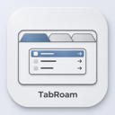
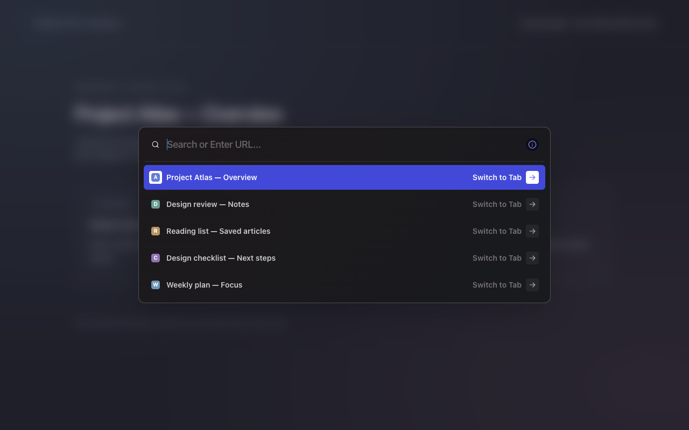

# TabRoam



TabRoam 是一个 Chrome Manifest V3 命令栏插件：统一查找已打开的标签页、本地书签和浏览历史，并按你的选择切换标签、打开网址或执行网络搜索。当前版本 **1.0.6**，Chrome **121+**；运行时无第三方依赖，无构建步骤。

**发布者：LaneXia** · 联系邮箱：[xialei0792@gmail.com](mailto:xialei0792@gmail.com)

[隐私政策 / Privacy policy](https://lane-xia.github.io/tabroam/) · [政策正文](store/PRIVACY-POLICY.md) · [权限说明](store/PERMISSIONS.md) · [数据处理说明](store/DATA-PRACTICES.md)

1.0.6 增加原生 `_locales/en` 与 `_locales/zh_CN` 名称、短描述元数据，默认 locale 为 `zh_CN`，不代表完整英文界面。后台已上传 1.0.6 草稿，英文详情 2826 字符、简体中文 1074 字符已分别保存，并在刷新和切换语言后验证与本地 JSON 一致；默认 `zh_CN`，3 张 global 截图保留。发布者联系邮箱已在后台验证；未提交审核、未上架。

## 安装

1. 下载本仓库代码并解压，或运行 `git clone https://github.com/Lane-Xia/tabroam.git`。
2. 在 Chrome 打开 `chrome://extensions/`，开启“开发者模式”。
3. 点击“加载已解压的扩展程序”，选择仓库中的 **extension** 文件夹，其中直接包含 `manifest.json`。
4. 固定 TabRoam 工具栏图标，在普通网页上点击图标或使用快捷键。

安装无需 npm、构建或本地服务器。更新源码后，在扩展管理页重新加载，并刷新已打开的网页。

## 使用

| 操作 | macOS | Windows |
| --- | --- | --- |
| 打开或关闭命令栏 | Cmd+Shift+Space | Ctrl+Shift+Space |
| 选择结果 | ↑ / ↓ | ↑ / ↓ |
| 执行结果 | Enter / 点击 | Enter / 点击 |
| 在来源标签页打开 | Cmd+Enter | Ctrl+Enter |
| 关闭并恢复焦点 | Esc / 点击面板外 | Esc / 点击面板外 |

快捷键可在 `chrome://extensions/shortcuts` 调整。空查询显示最近标签；输入标题、URL 或关键词时搜索普通窗口的标签页、书签和历史。已有标签优先切换，其他结果默认在新标签页打开。支持中英文文本、大小写不敏感、多关键词与轻度英文拼写容错；不提供拼音匹配或网页正文检索。

设置页可选择 Google、Bing、DuckDuckGo 或百度，并调整历史范围（默认180天，单次最多读取20,000条）。网络搜索仅在执行动作时导航到所选引擎，输入期间不请求在线搜索建议。



## 隐私与限制

标签、书签、历史和查询在设备本地处理，扩展不包含开发者数据接收服务器、分析或广告SDK。执行搜索或访问网址会向所选搜索引擎或目标站点发送正常浏览请求。政策由本仓库的 `docs/` 目录经 GitHub Pages 托管，GitHub会记录访问者IP用于安全目的，详见[隐私政策](https://lane-xia.github.io/tabroam/)。

- 原生测试曾复现快捷键唤起后立即开始中文输入时丢失首字符；建议等输入框可见并获焦后输入，该问题尚未完全修复。
- 网页浮层的封闭Shadow DOM不能隔离宿主网页捕获阶段的所有键盘或组合输入事件。
- 浏览器限制注入的页面使用独立扩展页；无痕窗口不启用。原生Windows输入行为尚未完整验证。

## 开发与测试

Node.js 22.12+：

```sh
npm test
```

真实浏览器测试需要安装开发依赖及本机Chrome：

```sh
npm install
npm run test:browser
```

可用 `CHROME_PATH` 指定Chrome可执行文件，`PUPPETEER_MODULE_PATH` 指定已有Puppeteer模块入口，`HEADED=1` 显示测试浏览器。测试使用独立配置和合成数据，保留其临时配置；浏览器自动化不代替原生操作系统快捷键及输入法验证。

## 目录

- `extension/`：全部运行代码和当前图标；直接加载此目录即可使用。
- `tests/`：核心逻辑、后台契约、启动回归及浏览器测试。
- `store/`：政策、权限、商店文案及合成演示数据截图。
- `docs/`：GitHub Pages政策页面，与插件附带政策保持一致。
